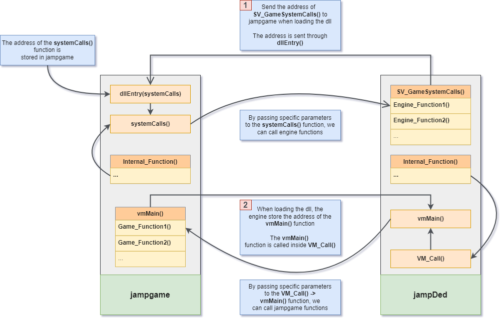
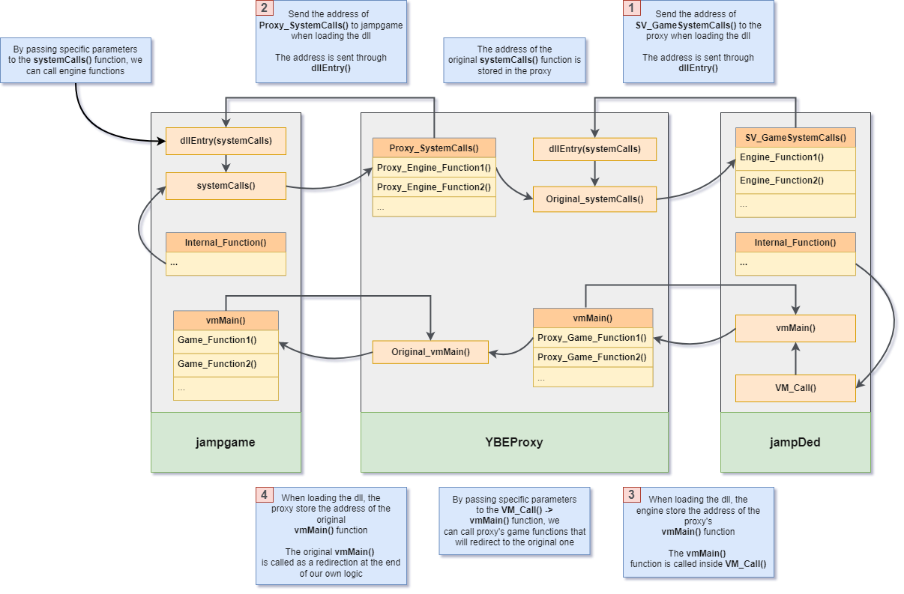
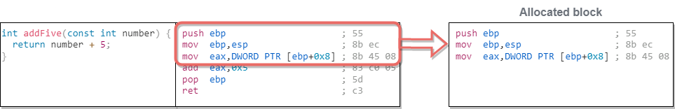
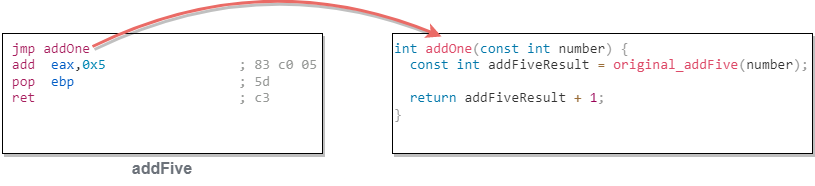
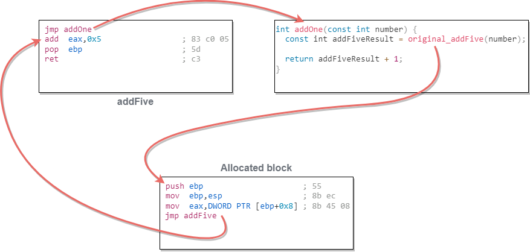

# Trampoline hooks

## 1. Introduction

A trampoline hook redirects a function of the engine to a function of the proxy. The proxy function can run code before and after the original, and can still call the original function through a small piece of code called the trampoline.

Usually, hooking a program means first injecting a library into it. Jedi Academy makes this easier: the engine (`jampDed`) loads the game module (`jampgame`) by itself. The proxy *is* the game module, so it already runs inside the server process and can patch the engine's code in memory.

## 2. How the proxy works

> [!WARNING]
> This is a simplification and does not match the code one to one.

### 2.1. Original workflow

The engine and the game module talk through two entry points:

- **Engine to game**: the engine calls the game's exported `vmMain(command, args...)` with a command such as `GAME_INIT`, `GAME_RUN_FRAME` or `GAME_CLIENT_COMMAND`.
- **Game to engine**: at load time, the engine calls the game's exported `dllEntry` with a pointer to its syscall function. The game then calls that function with a syscall number such as `G_PRINT` or `G_GET_USERCMD`.

[](images/FtLl2BB.png)

### 2.2. Proxy workflow

This diagram only shows how the proxy talks with `jampDed` and `jampgame` and intercepts the calls in both directions. It does not show the hooks and runtime patches.

[](images/Yus587M.png)

- The proxy exports `dllEntry` and `vmMain`, so the engine loads it as the game module.
- It keeps the engine's syscall pointer for itself.
- When it receives `GAME_INIT`, it loads the original `jampgame` and passes its own syscall function to the original `dllEntry`.
- From then on, every call in both directions goes through the proxy.

`GAME_INIT` is also where the proxy patches the engine.

OpenJK prefers tables of function pointers, exchanged through `GetModuleAPI`. The proxy does not export `GetModuleAPI`, so OpenJK falls back to `dllEntry` and `vmMain` (its legacy game API), and the same code path runs on both engines.

## 3. Building a trampoline step by step

The original `jampDed` and `jampgame` are 32-bit, so all examples assume x86.

Here is the function to hook:

```c
int addFive(const int number) {
  return number + 5;
}
```

`MSVC x86` assembly (https://godbolt.org/z/Kh5x9Wo8a):

```asm
push   ebp                      ; 55
mov    ebp,esp                  ; 8b ec
mov    eax,DWORD PTR [ebp+0x8]  ; 8b 45 08
add    eax,0x5                  ; 83 c0 05
pop    ebp                      ; 5d
ret                             ; c3
```

The function that replaces it calls the original through `original_addFive`:

```c
int addOne(const int number) {
  const int addFiveResult = original_addFive(number);

  return addFiveResult + 1;
}
```

### 3.1. Find how many bytes to replace

To run `addOne` when `addFive` is called, we write a `jmp` at the start of `addFive`. A relative `jmp` takes 5 bytes:

```asm
jmp rel32                       ; e9 = 1 byte
                                ; rel32 = 4 bytes
```

The 4-byte operand is relative to the end of the `jmp` instruction:

```
rel32 = destination - (address of the jmp + 5)
```

So we need at least 5 bytes at the start of `addFive`. But we cannot cut an instruction in half:

```asm
push   ebp                      ; 55       = 1 byte
mov    ebp,esp                  ; 8b ec    = 2 bytes
mov    eax,DWORD PTR [ebp+0x8]  ; 8b 45 08 = 3 bytes
                                ; total    = 6 bytes
```

> [!WARNING]
> Instructions cannot be split, so we have to replace 6 bytes, not 5.

The proxy finds this length automatically: `HookUtils::GetLen` uses a length disassembler (HDE) and adds up instruction lengths until it reaches at least 5 bytes.

### 3.2. Save the original instructions

We are about to overwrite these 6 bytes, and we still want to run them when we call the original function. So we allocate a block of executable memory and copy the 6 bytes into it (`VirtualAlloc` with `PAGE_EXECUTE_READWRITE` on Windows, `mmap` with `PROT_EXEC` on Linux).

[](images/VN5dcvH.png)

The block needs 5 more bytes. After running the saved instructions, execution must continue in `addFive`, 6 bytes after its start. That takes another `jmp` (see 3.4). The block is therefore 6 + 5 bytes.

### 3.3. Jump to `addOne`

Now we can write the `jmp` at the start of `addFive`:

1. Make the code page writable (`VirtualProtect` / `mprotect`).
2. Fill the 6 bytes with `nop` (`0x90`), then write `e9` followed by the relative offset to `addOne`.
3. Restore the page protection.

`addFive` now looks like this:

```asm
jmp    addOne                   ; e9 + rel32 = 5 bytes
nop                             ; 90 = leftover 6th byte
add    eax,0x5                  ; 83 c0 05
pop    ebp                      ; 5d
ret                             ; c3
```

[](images/5qUO4ZG.png)

### 3.4. Call the original function

`addFive` now jumps straight to `addOne`, but `addOne` still needs the result of the original `addFive`.

The block allocated in 3.2 is the trampoline, and its address becomes `original_addFive`:

- the first 6 bytes are the saved instructions;
- the last 5 bytes are a `jmp` to `addFive + 6`, right after our patch. Jumping to the start of `addFive` would run our `jmp` again and loop forever.

[](images/q5nUpJE.png)

Result: `addFive(1)` returns `7`. The call goes to `addOne`, which calls the original `addFive` (+5) and adds 1.

## 4. In the proxy code

| Element | Where | Role |
| --- | --- | --- |
| `HookUtils::HookEntry` | [HookUtils.hpp](../src/JKA_YBEProxy/RuntimePatch/HookUtils/HookUtils.hpp) | Hook name, target address, pointer that receives the trampoline (`Original_X`), replacement function (`Proxy_X`) |
| `HookUtils::Attach` | [HookUtils.hpp](../src/JKA_YBEProxy/RuntimePatch/HookUtils/HookUtils.hpp) | `GetLen`, then `GetTramp` (steps 3.1, 3.2, 3.4), then writes the `jmp` (step 3.3) |
| `HookUtils::Detach` | [HookUtils.hpp](../src/JKA_YBEProxy/RuntimePatch/HookUtils/HookUtils.hpp) | Copies the saved bytes back and frees the trampoline |
| `HookUtils::Patch`, `Patch_NOP_Bytes` | [HookUtils.cpp](../src/JKA_YBEProxy/RuntimePatch/HookUtils/HookUtils.cpp) | Inline patches with no trampoline (one byte, or a block of `nop`) |
| Hook list | [Proxy_Engine_Patch.cpp](../src/JKA_YBEProxy/RuntimePatch/Engine/Proxy_Engine_Patch.cpp) | Every hook, attached on `GAME_INIT` and detached on `GAME_SHUTDOWN` |
| Addresses | [Proxy_Engine_Wrappers.hpp](../src/JKA_YBEProxy/RuntimePatch/Engine/Proxy_Engine_Wrappers.hpp) | `{ Windows, Linux }` address of each engine function, variable and cvar |

The proxy only patches the engine when the `version` cvar matches the original 1.01 Windows or Linux binary.

## 5. Pitfalls

- **Relative instructions.** If the copied bytes contain a relative `call`, `jmp` or conditional jump, the copy in the trampoline points to the wrong place. Their operand has to be relocated, or the function cannot be hooked this way. The current code does not check for this, see A1 in [audit/improvements.md](audit/improvements.md).
- **`static` functions.** In the original binaries, the compiler may have inlined a `static` function into its callers, or given it a non-standard calling convention (arguments in registers). Check the disassembly first:
  - The function is standalone, and callers use `call` with the arguments on the stack: a normal trampoline works.
  - The function is inlined: the inlined call sites never reach its address, so a hook there misses them. Hook the callers instead (copy them into the proxy), or filter in a non-static function higher up the call chain. F1 in [audit/fixes.md](audit/fixes.md) does this for `SVC_RemoteCommand`, `SVC_Status` and `SVC_Info`.
  - The function uses a non-standard convention: write an assembly stub that reads the arguments where the binary puts them, then calls the C++ function. See `Proxy_Shell.hpp`.
- **Calling convention.** The replacement function must use exactly the same calling convention and arguments as the original: `cdecl` in general, `QDECL` for variadic functions.
- **Unloading.** The engine unloads and reloads the game module, which is the proxy, on every map change. If a hook function is still on the call stack at that moment, it returns into unloaded code. This causes the `rcon map` / `rcon map_restart` crash. When a hook can lead to a map change, use a filter that returns, then a `jmp` to the original. See F1 in [audit/fixes.md](audit/fixes.md).
- **Wrong binary.** The only check is the `version` cvar string. Checking the expected bytes at each address before patching would be safer, see A1 in [audit/improvements.md](audit/improvements.md).
